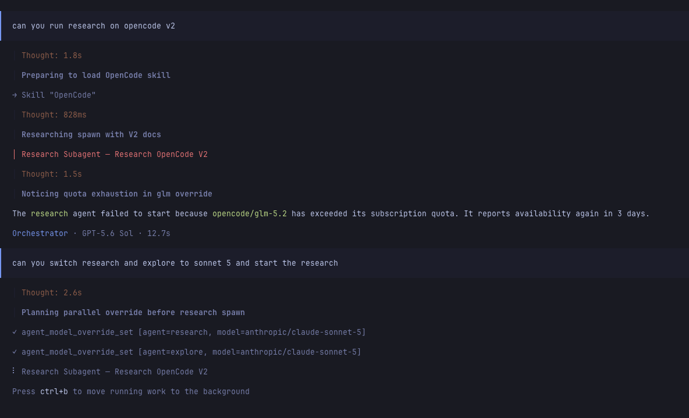

# opencode2-agent-model-override

[](https://github.com/davidprokopec/opencode2-agent-model-override/actions/workflows/ci.yml)
[](https://www.npmjs.com/package/opencode2-agent-model-override)
[](LICENSE)

An [OpenCode V2](https://opencode.ai/v2/docs/) plugin that runs one of your
agents on a different model for the current session only.

When a provider runs out of quota, you can tell the agent you are already
talking to which agent is affected and what to use instead:

> the explore agent's provider is out of quota, use openai/gpt-5.6-terra for it

From then on every spawn of that agent **made from that session** — including a
normal built-in subagent spawn — runs on the replacement model, with the same
system prompt, description, permissions, request settings and step budget.

An override belongs to the session that set it. Another session, open at the
same time or started later, still spawns that agent on the model its
configuration defines. The override is written to disk under that session's id,
so it survives a restart of OpenCode and is still in effect when you come back
to the same session, until you clear it.



## Install

The V2 plugin API is beta and host-coupled. This release is built and verified
against `@opencode-ai/plugin@0.0.0-beta-17639` (`opencode2 --version` →
`v0.0.0-beta-17639`). Always install with the explicit `@beta` tag:

```jsonc
// ~/.config/opencode/opencode.jsonc
{
  "plugins": ["opencode2-agent-model-override@beta"],
}
```

Restart OpenCode, then confirm it loaded:

> list the agent model overrides

For local development, clone the repository, run `bun install`, and point the
same config entry at the checkout's `src/index.ts` by absolute path.

## How it works

The plugin does **not** change the agent you name. OpenCode's own config
transform re-applies every configured agent at an order a plugin cannot control,
so a change written onto an existing agent id is overwritten again on the next
reload. Instead:

1. The plugin snapshots the agents as OpenCode resolved them, from
   `ctx.agent.list()`.
2. Its agent transform adds, for each session's override, a **hidden variant**:
   a deep copy of the source agent under a new id, with `hidden: true`,
   `mode: "subagent"` and the replacement model. Every other resolved field —
   system prompt, description, request settings, permissions, steps, colour and
   anything a later OpenCode adds — is copied verbatim, with no nested object
   shared with the original. The original agent record is not read from or
   written to by the transform at all. Agent registries are scoped to an
   OpenCode location, so every relevant session's variants are materialized
   side by side in that location; the id of each carries the session it belongs
   to.
3. A `execute.before` hook on the spawn tool reads the overrides of the session
   whose turn is making the call, re-snapshots the agents, so the variant is a
   copy of the source as it is defined right now, and then rewrites the
   requested agent id to that session's variant. A session with no override of
   its own is left alone even when another session overrode the same agent.
   Both the public `subagent`/`agent` shape and the internal
   `task`/`subagent_type` shape are recognised; anything else is left alone.

Because the spawn still goes through OpenCode's own tool with a real agent id,
everything native about it is preserved: a real child session, nested under the
parent the usual way, on the variant's model, with the variant's tools and
permissions.

Variants are hidden, so they are not advertised as agents you can pick, and the
plugin never offers them as targets for another override.

### The generated id

```
explore  →  explore-mo-74cab666
```

A readable prefix taken from the source id (lowercased, non-alphanumerics
collapsed to `-`, truncated) plus `-mo-` and the first eight hex characters of
`sha256("opencode2-agent-model-override:" + <session id> + ":" + <source id>)`.
It is:

- **per session** — the session that set the override is part of the hashed
  input, so two sessions that override the same agent get two different hidden
  agents and can run it on different models at the same time. The same agent
  overridden in a different session therefore has a different id;
- **deterministic** — the same agent overridden in the same session always maps
  to the same variant, across reloads and restarts, so you can name it in
  configuration;
- **legal and bounded** — lowercase letters, digits and dashes only, never more
  than 64 characters, however long the session id is;
- **collision resistant** — two agents whose readable prefixes coincide
  (`my.agent` and `my-agent`) still get different ids, and a variant id is never
  equal to the id it was derived from;
- **never someone else's** — if an agent already answers to the id, the next
  salted candidate for the same source is used instead (`...#1`, `...#2` in the
  hashed input), which is just as deterministic. The plugin overwrites no agent
  it did not create; in the impossible case that every candidate is taken, the
  override stays dormant and spawns are left alone.

## Use it in conversation

The three tools are ordinary model-facing tools, so plain language is enough:

- "the explore agent is out of quota, switch it to `openai/gpt-5.6-terra`"
- "run `review` on `anthropic/claude-sonnet-5` for now"
- "which agents have a model override?"
- "put explore back on its configured model"
- "clear all model overrides"

All three act on the session you are talking in, and only on it.

## Tools

### `agent_model_override_set`

```json
{ "agent": "explore", "model": "anthropic/claude-sonnet-5" }
```

`model` is the canonical `provider/model`, optionally with a variant as
`provider/model#variant` — for example `openai/gpt-5.6-sol#high`.
A model id may itself contain slashes (`openrouter/anthropic/claude-sonnet-4.5`).

Both arguments are trimmed. The call is rejected, and nothing is written, if the
agent is not defined in the current OpenCode, the model is not in the catalog,
or the requested variant does not exist. The error names the agents and variants
that do exist, so a wrong guess is one turn to fix.

On success the override is persisted for the calling session, the agents are
re-snapshotted and reloaded so the hidden variant exists, and the reply names
the variant that future spawns from this session will be routed to.

### `agent_model_override_list`

Takes no input. Lists the overrides of the calling session — never another
session's — and their targets, and notes the hidden agent spawns are routed to.
It also flags an override whose agent is not defined here (dormant, kept in case
that agent appears later) or whose model is no longer in the catalog.

### `agent_model_override_clear`

```json
{ "agent": "explore" }
```

```json
{ "all": true }
```

With neither argument it reports which overrides the session has active rather
than guessing. Clearing removes the persisted entry and reloads, so that
session's variant stops being materialized and disappears; an override another
session set is left alone, and `all: true` empties the calling session only. The
source agent is untouched by all of this and keeps working exactly as its
configuration defines.

## Where the state lives

One versioned JSON document, with the overrides grouped by the session that set
them:

```
${XDG_STATE_HOME:-~/.local/state}/opencode2-agent-model-override/overrides.json
```

```json
{
  "version": 2,
  "sessions": {
    "ses_7f3c2a19b": {
      "explore": "openai/gpt-5.6-terra",
      "review": "anthropic/claude-sonnet-5"
    },
    "ses_91be0d4a2": {
      "explore": "anthropic/claude-haiku-5"
    }
  }
}
```

A session key disappears from the document as soon as its last override is
cleared.

Writes replace the file atomically (write a sibling, then rename), so another
OpenCode starting at the same moment never reads a half-written document.
Nothing is cached: the document is read again for every list and again inside
every change, so a plugin instance never serves overrides that another one has
already replaced.

OpenCode instantiates a plugin once per location, so one service holds several
instances over the same document. They take turns on a lock keyed by the file
path, and each change is a read, a modification and a write while that lock is
held, so two of them cannot lose each other's update.

Independent OpenCode service processes are not coordinated with one another.
Run one service against a given state file; two simultaneous services can still
overwrite each other's change.

If the file is missing, the plugin starts with no overrides. If it is malformed,
the plugin logs a warning and behaves as if empty rather than failing to load;
the next successful write replaces the bad document. An unparsable single entry
is skipped and the rest still apply.

A **version 1** document — the earlier format, one flat override map for the
whole installation — reads as no overrides at all. Those entries belonged to no
session, so there is no session they could be handed to without giving it
overrides someone set elsewhere. They are simply not in effect any more, and the
next write replaces the file with a version 2 one. Set the overrides you still
want in the session you want them in.

Nothing about the variants is persisted. They exist only as long as the
plugin's transform is registered, and are rebuilt from every session's overrides
and the current agents on every reload.

## Semantics and limitations

- **Per session, and persisted for that session.** An override is in effect for
  the session that set it and for no other, whichever project or directory the
  other session is in. It is written to disk under that session's id, so it
  survives a restart and is still in effect when that session continues. Two
  sessions can override the same agent to different models at the same time;
  each gets a hidden copy of its own and neither sees the other's.
- **A nested spawn belongs to the session making it.** The session a spawn is
  attributed to is the one whose turn is calling the spawn tool. When a subagent
  spawns another subagent, that is the subagent's own child session doing the
  spawning, and that child session has an id of its own — it does not inherit
  the overrides of the session that started it. An override applies there only
  if it is set there. Resuming or continuing a session keeps its id, so its
  overrides come back with it.
- **Explicit redirection, not automatic retry.** The plugin does not watch for
  quota errors and does not retry a call that already failed. You tell it which
  agent to redirect; it redirects future spawns of that agent from your session.
  The turn that hit the quota wall is over, and re-running that work is a
  separate instruction.
- **The original agent is never modified.** Its `model` and every other field
  stay exactly as configured. Redirection happens by spawning a copy instead,
  which is why it survives OpenCode's config transform.
- **The child session shows the variant's id.** A redirected subagent runs as
  `explore-mo-74cab666`, not `explore`, so that id is what appears in the
  session header and in anything keyed on the agent id. This is cosmetic, but it
  is visible. The id is specific to the session that set the override, so the
  same agent redirected in another session shows a different one.
- **Scoped permission rules must name the variant.** A parent's rules are
  matched against the id the child actually runs as. A rule scoped to `explore`
  does not cover `explore-mo-74cab666`. A wildcard subagent permission keeps
  working unchanged; a scoped one needs a pattern such as `explore-mo-*`, since
  the exact id depends on the session the override was set in. The id is
  deterministic for that session and is reported by `agent_model_override_set`
  and `agent_model_override_list`, so it can also be written out in full.
- **Nesting and child sessions are native.** The spawn is still OpenCode's own,
  with a real agent id, so the child session is created and nested exactly as it
  would have been without the plugin.
- **Applies from the next spawn.** Setting an override reloads the agents, so
  subsequent spawns pick it up without a restart. A subagent already running
  keeps the model it started with.
- **Persisted overrides activate before the first native spawn.** After a
  restart, the first spawn from a session that has an override materializes the
  variants and is then redirected, so nothing is lost by not having used a tool
  first in that session.
- **The copy is refreshed before every redirected spawn.** The agents are
  re-snapshotted and the variant rebuilt each time a spawn is about to be
  redirected, so an edited prompt, a revoked permission or a changed request
  setting applies to the very next spawn. If that snapshot fails, the spawn is
  left pointing at the original agent rather than at a stale copy.
- **An override for an unknown agent stays dormant.** It is remembered for its
  session, listed as dormant, and materializes if a project later defines an
  agent with that id. A spawn of that unknown id is left untouched.
- **Model availability is checked when you set it.** If a provider is removed
  later, the override remains and `agent_model_override_list` flags it.

## Development

```sh
bun install
bun run check      # typecheck, lint, test
```

Core logic is server independent: the store takes an injected filesystem, the
variant manager takes plain agent records and a draft, the spawn router takes an
injected view of the overrides, and the tools take an injected environment — so
`test/` exercises the real behaviour with in-memory fakes.

| Module | Responsibility |
| --- | --- |
| `src/store.ts` | The versioned, session keyed JSON document on disk |
| `src/registry.ts` | The overrides per session, read fresh and changed under a per-file lock |
| `src/variant.ts` | Variant ids per session and agent, the source snapshot, the agent transform |
| `src/spawn.ts` | Reading and rewriting a raw spawn tool input |
| `src/tools.ts` | The three model-facing tools |
| `src/index.ts` | Wiring, and the synchronize-then-reload step |

## License

MIT
